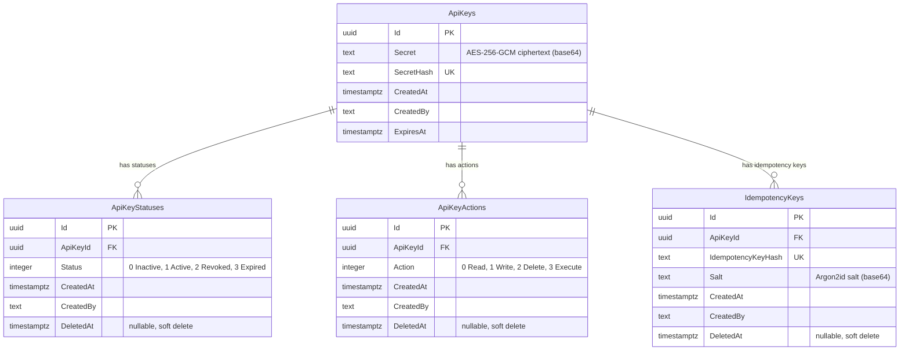

# Database Schema

Locksmith stores API keys in PostgreSQL across four tables, managed by EF Core (Npgsql) migrations in `Src/Infrastructure/Migrations/`. The design rests on four principles:

- **No plaintext secrets** — secrets are looked up by hash and stored only as ciphertext.
- **Append-only audit trail** — state and permission changes are new rows, never updates.
- **Least privilege defaults** — keys start `Inactive`, with only the actions explicitly requested.
- **Forensic evidence** — soft deletes record *when* something was revoked instead of erasing it.

Table and column names are EF Core defaults: **PascalCase**, quoted in SQL (`"ApiKeys"."SecretHash"`).

## Schema overview



Column types are as generated: `uuid`, `text` (no length limits), `integer` for enums, and `timestamp with time zone`. No column has a database default — every value, including `CreatedAt`, is set by the application.

`CreatedBy` is always the constant `"api-client"` (`WellKnown.CallerIdentities.API_CLIENT`). With a single static bearer token there is no per-caller identity to record, and the token itself must never be persisted.

---

## Tables

### `ApiKeys`

The identity and metadata table. A key row is created once at issuance and never updated — it is the immutable anchor for all state and permission history.

| Column | Type | Constraints | Purpose |
|---|---|---|---|
| `Id` | `uuid` | PK | Unique identifier for the key |
| `Secret` | `text` | Not null | `nonce ‖ ciphertext ‖ tag` of the raw secret, base64. Encrypted with AES-256-GCM under a per-key DEK |
| `SecretHash` | `text` | Not null, unique | Base64 SHA-256 of the raw secret, used for lookups by secret |
| `CreatedAt` | `timestamptz` | Not null | Moment the key was issued |
| `CreatedBy` | `text` | Not null | Always `"api-client"` |
| `ExpiresAt` | `timestamptz` | Not null | Expiry moment (defaults to 30 days after creation). Nothing acts on it automatically yet |

**Immutability:** `ApiKey` implements `IAppendOnlyTable` like the other three tables (see [Append-only enforcement](#append-only-enforcement)). Unlike them, it has no `DeletedAt` column, so the only allowed operation is insert. `DELETE /api-key` (see [api-surface.md](api-surface.md#delete-a-key)) never touches this row. It soft-deletes the related `ApiKeyStatuses`, `ApiKeyActions`, and `IdempotencyKeys` rows instead.

---

### `IdempotencyKeys`

Links each API key to the server-generated idempotency key returned at creation (or rotation). It stores the hash used to find the key and the salt needed to re-derive the DEK.

| Column | Type | Constraints | Purpose |
|---|---|---|---|
| `Id` | `uuid` | PK | Unique identifier for this record |
| `ApiKeyId` | `uuid` | FK → `ApiKeys.Id`, not null | The key this record belongs to |
| `IdempotencyKeyHash` | `text` | Not null, unique | Base64 SHA-256 of the idempotency key Locksmith generated and returned to the caller |
| `Salt` | `text` | Not null | Random 32-byte salt (base64) for Argon2id DEK derivation; unique per key |
| `CreatedAt` | `timestamptz` | Not null | Same moment as the key |
| `CreatedBy` | `text` | Not null | Always `"api-client"` |
| `DeletedAt` | `timestamptz` | Nullable | Set by `DELETE /api-key` or rotation. From then on the idempotency key no longer resolves |

Every mutating endpoint except create and validate finds its target key through this table, by hashing the `idempotencyKey` in the request body.

---

### `ApiKeyStatuses`

An append-only history of state transitions. Each transition soft-deletes the current row and inserts a new one, so the table only grows.

| Column | Type | Constraints | Purpose |
|---|---|---|---|
| `Id` | `uuid` | PK | Unique identifier for this status record |
| `ApiKeyId` | `uuid` | FK → `ApiKeys.Id`, not null | The key this status belongs to |
| `Status` | `integer` | Not null | `ApiKeyStatusEnum`: `0` Inactive, `1` Active, `2` Revoked, `3` Expired |
| `CreatedAt` | `timestamptz` | Not null | Moment the transition occurred; defines the timeline |
| `CreatedBy` | `text` | Not null | Always `"api-client"` |
| `DeletedAt` | `timestamptz` | Nullable | Set when this status is superseded or the key is deleted |

The **current** status is the newest row whose `DeletedAt` is null. History reads (`GET .../status/history`) return every row, including soft-deleted ones.

**Status transition guard:** `PATCH /api-key/status` (see [api-surface.md](api-surface.md#update-a-keys-status)) uses a **terminal-state check, not a full transition matrix**. Before any write, `ApiKeyStatusRepository.SoftDeleteAsync` throws `ConflictException` (`409`) when the *current* status is already `Revoked` or `Expired`:

```
Inactive | Active ──(any status)──> Inactive | Active | Revoked | Expired

Revoked  ──X──> (blocked, 409)
Expired  ──X──> (blocked, 409)
```

---

### `ApiKeyActions`

A junction table linking keys to their granted permissions. Each row is one grant of one action. Granting inserts a row; revoking soft-deletes it.

| Column | Type | Constraints | Purpose |
|---|---|---|---|
| `Id` | `uuid` | PK | Unique identifier for this grant |
| `ApiKeyId` | `uuid` | FK → `ApiKeys.Id`, not null | The key this grant belongs to |
| `Action` | `integer` | Not null | `ApiKeyActionEnum`: `0` Read, `1` Write, `2` Delete, `3` Execute |
| `CreatedAt` | `timestamptz` | Not null | Moment the permission was granted |
| `CreatedBy` | `text` | Not null | Always `"api-client"` |
| `DeletedAt` | `timestamptz` | Nullable | Moment the permission was revoked |

**Active-grant uniqueness:** a **partial** unique index on `(ApiKeyId, Action)` filtered to `"DeletedAt" IS NULL` allows at most one *active* grant per action per key. Revoked (soft-deleted) rows are excluded, so an action can be revoked and granted again any number of times, leaving a full history. This index is the authoritative guard against concurrent duplicate grants.

---

## Indexes

| Index | Table | Columns | Purpose |
|---|---|---|---|
| `IX_ApiKeys_SecretHash` | `ApiKeys` | `SecretHash` (unique) | Look up a key by presented secret (`X-Api-Key`, validate) |
| `IX_IdempotencyKeys_IdempotencyKeyHash` | `IdempotencyKeys` | `IdempotencyKeyHash` (unique) | Look up a key by idempotency key (all mutations) |
| `IX_IdempotencyKeys_ApiKeyId` | `IdempotencyKeys` | `ApiKeyId` | FK index |
| `IX_ApiKeyStatuses_ApiKeyId_CreatedAt` | `ApiKeyStatuses` | `(ApiKeyId, CreatedAt DESC)` | Find the most recent status for a key |
| `IX_ApiKeyActions_ApiKeyId` | `ApiKeyActions` | `ApiKeyId` | Find all actions for a key |
| `IX_ApiKeyActions_ApiKeyId_Action_Active` | `ApiKeyActions` | `(ApiKeyId, Action)` unique, `WHERE "DeletedAt" IS NULL` | At most one active grant per action |

---

## Foreign keys

`IdempotencyKeys.ApiKeyId`, `ApiKeyStatuses.ApiKeyId`, and `ApiKeyActions.ApiKeyId` all reference `ApiKeys.Id` with **`ON DELETE CASCADE`** (the EF Core default for required relationships).

The application never hard-deletes an `ApiKeys` row (the append-only guard forbids it), so the cascade never fires in normal operation. A manual `DELETE FROM "ApiKeys"` run outside the application, however, **would** erase that key's entire audit history. That is one more reason to apply the [database privileges](#setting-up-database-privileges-production) below.

---

## Append-only enforcement

All four entities implement `Domain.IAppendOnlyTable`. Enforcement is **application-layer only**, in `AppDbContext.SaveChanges`/`SaveChangesAsync`. Before delegating to EF Core, it walks the change tracker and throws `AppendOnlyViolationException` (surfaced as `500`) when any `IAppendOnlyTable` entity is:

- `Deleted` (a hard delete), or
- `Modified` with a change to any property other than `DeletedAt`.

This single guard covers all four tables. Soft-deleting via `DeletedAt` is the only update ever allowed, and `ApiKey`, which has no `DeletedAt`, can never change after insert.

There is **no database-level enforcement yet**. The `AddAppendOnlyConstraints` migration is empty, and no privileges are revoked. Anything that connects with the application's credentials outside EF Core (psql, another tool, a compromised process) can still update or delete rows. See [Setting up database privileges](#setting-up-database-privileges-production) for the recommended fix.

---

## Design decisions

### Why separate `IdempotencyKeys` from `ApiKeys`?

- **`ApiKeys`** holds the immutable identity and metadata, plus the encrypted secret.
- **`IdempotencyKeys`** holds what's needed to *act on* a key: the lookup hash for mutations and the salt for decryption. Deleting or rotating a key soft-deletes this row, which cuts off every management operation in one step while the `ApiKeys` row and its history stay intact.

Keeping the salt off `ApiKeys` also means key metadata reads never load it.

### Why hash the secret *and* encrypt it?

The two solve different problems:

- **`SecretHash`** (SHA-256, no salt) gives an exact-match index lookup when a caller presents a secret. The secret is 32 random bytes, so a salt adds nothing: there's no dictionary to precompute against.
- **`Secret`** (AES-256-GCM ciphertext) lets the caller recover the raw secret later via `POST /api-key/secret`, without Locksmith ever storing plaintext.

The encryption key (DEK) is derived per key with **Argon2id from the plaintext idempotency key plus the stored `Salt`**. The idempotency key is never stored (only its hash), so the database alone holds neither the plaintext nor the means to decrypt it. Presenting the wrong idempotency key derives the wrong DEK, and the GCM tag check fails (`DecryptionFailedException` → `422`). Losing the idempotency key makes the secret unrecoverable. See [ADR-002](../Decisions/ADR-002-api-key-creation.md).

> **Note:** the Argon2id parameters (`CryptoSettings`) aren't stored per key. Changing them after keys exist makes those keys' secrets undecryptable — see [TODO.md](../TODO.md).

### Why append-only for state history?

State transitions are forensic events. A complete timeline of what changed and when is essential for:

- **Audit:** proving that a key was revoked at a specific moment.
- **Forensic investigation:** tracing the exact sequence of state changes if a key's security is questioned.
- **Tamper resistance:** history is never rewritten through the application. Database privileges (recommended below) would extend that to direct access.

### Why soft deletes?

A `DeletedAt` timestamp preserves evidence. When a permission is revoked or a status superseded, the row stays and records the moment it stopped applying. That enables audit queries ("when was this permission revoked?") and full timeline reconstruction. Hard deletes would destroy this evidence.

---

## Validation at application boundaries

The schema enforces **structural integrity** (unique and partial-unique indexes, foreign keys). Business rules live in the application:

- **Terminal-state guard** — reject a status change (`409`) when the current status is `Revoked` or `Expired`.
- **Duplicate grant** — reject granting an already-active action (`409`), backstopped by the partial unique index for concurrent requests.
- **Append-only** — `AppendOnlyViolationException` on any forbidden modification.
- **Lookups** — secrets and idempotency keys are matched by hash through a SQL equality lookup on the unique indexes. `CryptographicOperations.FixedTimeEquals` is used only for the bearer-token check.
- **Decryption** — the stored `Salt` plus the caller's idempotency key re-derive the DEK that decrypts `ApiKeys.Secret`.

---

## Performance considerations

### Append-only table growth

`ApiKeyStatuses` and `ApiKeyActions` grow with every transition and grant/revoke cycle. For long-lived deployments, consider archiving keys that have been `Revoked`/`Expired`/deleted beyond a retention window (e.g., 2 years) into separate archive tables, keeping the hot tables lean. The append-only rule still applies to the archive.

### Main query patterns

| Query | Index used |
|---|---|
| Key by secret: `WHERE "SecretHash" = @hash` | `IX_ApiKeys_SecretHash` |
| Key by idempotency key: `WHERE "IdempotencyKeyHash" = @hash` | `IX_IdempotencyKeys_IdempotencyKeyHash` |
| Current status: `WHERE "ApiKeyId" = @id AND "DeletedAt" IS NULL ORDER BY "CreatedAt" DESC LIMIT 1` | `IX_ApiKeyStatuses_ApiKeyId_CreatedAt` |
| Active actions: `WHERE "ApiKeyId" = @id AND "DeletedAt" IS NULL` | `IX_ApiKeyActions_ApiKeyId` / partial unique index |

---

## Setting up database privileges (production)

**Recommended, not yet applied.** To enforce append-only at the database layer as well, restrict the application role (shown here as `app_user`). EF Core issues `UPDATE` for soft deletes, so three tables need a column-level `UPDATE` grant on `"DeletedAt"` only:

```sql
-- ApiKeys: insert-only, never updated after creation
REVOKE UPDATE, DELETE ON "ApiKeys" FROM app_user;
GRANT SELECT, INSERT ON "ApiKeys" TO app_user;

-- Soft-deletable tables: insert, and set DeletedAt only
REVOKE UPDATE, DELETE ON "ApiKeyStatuses", "ApiKeyActions", "IdempotencyKeys" FROM app_user;
GRANT SELECT, INSERT ON "ApiKeyStatuses", "ApiKeyActions", "IdempotencyKeys" TO app_user;
GRANT UPDATE ("DeletedAt") ON "ApiKeyStatuses", "ApiKeyActions", "IdempotencyKeys" TO app_user;
```

Migrations would then need to run under a separate, more privileged role. With these grants in place, a compromised application layer still cannot rewrite or erase audit history.
